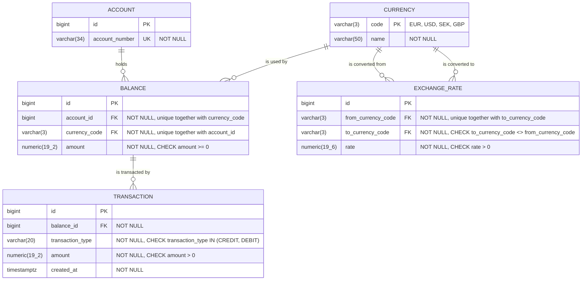

# Bank Account Service

## 1. Goal

A self-contained REST microservice for managing multi-currency bank accounts, built with Java and Spring Boot.

## 2. Description

Each account can hold money in four currencies (EUR, USD, SEK, GBP), each with its own balance. The application starts with pre-loaded demo accounts, exchange rates and currencies. The service allows:

- adding money to an account
- debiting money from an account (in one currency only)
- getting account balances
- currency exchange using fixed exchange rates

Balances are never edited directly. They only change through these operations, and every change is recorded as a transaction.

## 3. Tech stack

- Java 25, Spring Boot 4 (Web MVC, Data JPA, Validation)
- PostgreSQL 17, started automatically through Docker Compose
- Liquibase for the schema and seed data
- springdoc-openapi (Swagger UI)
- JUnit 5, Mockito, MockMvc

## 4. Running the application

**Requirements:** Java 25 and **Docker running**. PostgreSQL runs in a container defined in `compose.yaml`, and Spring Boot starts it automatically.

```bash
./gradlew bootRun
```

On startup, Liquibase creates the tables and loads the seed data. The app runs on `http://localhost:8080`.

**Swagger UI:** http://localhost:8080/swagger-ui.html: try all endpoints from the browser.

**Database** (e.g. for IntelliJ's Database tool): `localhost:5433`, database `bank_account`, user `bank`, password `secret`.

To reset the database to its initial state: `docker compose down -v`, then start the app again.

### Demo data

| Account number | Balances |
|---|---|
| `EE382200221020145685` | none at start |
| `EE162200001234567890` | none at start |

Balances are created on the first credit in a currency (see [Design decisions](#7-design-decisions)).

Exchange rates are fixed and derived from one EUR-based rate per currency (**1 EUR = 1.08 USD = 11.40 SEK = 0.84 GBP**), so all 12 pairs are consistent with each other and converting back and forth never creates money.

## 5. API

All endpoints are under `/api/accounts`. The account is identified by `accountNumber` in the request body (or as a query parameter for the GET request).

### Add money: `POST /api/accounts/credit`

```json
{ "accountNumber": "EE382200221020145685", "currency": "EUR", "amount": 100.00 }
```
Response `200`: the new balance in that currency:
```json
{ "currency": "EUR", "balance": 100.00 }
```

### Debit money: `POST /api/accounts/debit`

Same request body as credit. Before debiting, the service calls an external system (simulated logging, see [External system call](#external-system-call)). Only one currency is used; there is no automatic currency exchange.

Response `200`:
```json
{ "currency": "EUR", "balance": 70.00 }
```

### Get balances: `GET /api/accounts/balances?accountNumber=EE382200221020145685`

Response `200`:
```json
[
  { "currency": "EUR", "balance": 70.00 },
  { "currency": "SEK", "balance": 5.00 }
]
```

### Exchange currency: `POST /api/accounts/exchange`

`amount` is in the source currency (`fromCurrency`).
```json
{ "accountNumber": "EE382200221020145685", "fromCurrency": "EUR", "toCurrency": "USD", "amount": 50.00 }
```
Response `200`: both updated balances, the rate used and the converted amount:
```json
{
  "from": { "currency": "EUR", "balance": 20.00 },
  "to":   { "currency": "USD", "balance": 54.00 },
  "rate": 1.080000,
  "convertedAmount": 54.00
}
```

### Errors

All errors use the same format. `fieldErrors` is only filled for validation errors.
```json
{
  "message": "Request body contains invalid fields",
  "timestamp": "2026-10-12T17:24:38.150997Z",
  "fieldErrors": {
    "amount": "must be greater than 0",
    "accountNumber": "must not be blank"
  }
}
```

| Status | When |
|---|---|
| 400 | invalid request (validation, malformed JSON, missing parameter), unsupported currency, same source and target currency, exchange amount too small (converts to less than 0.01) |
| 404 | account not found, no balance in that currency (debit) |
| 409 | conflict with a concurrent operation (e.g. a lock conflict), the client can retry |
| 422 | insufficient funds |
| 500 | unexpected error (no internal details are returned) |
| 503 | the external logging system failed or timed out, nothing was changed |

## 6. Database

The schema is defined only by Liquibase migrations in `src/main/resources/db/changelog/changes/`, numbered in execution order (`001`–`005` create the tables, `006`–`008` load the seed data). Hibernate runs with `ddl-auto=validate`, so the app fails to start if the entities don't match the schema.



(`numeric(19_2)` stands for `NUMERIC(19,2)`; Mermaid does not allow commas in type names.)

- **Money** is stored as `NUMERIC(19,2)` and handled as `BigDecimal`, never as floating point.
- **Exchange rates** use `NUMERIC(19,6)`, because a rate is a multiplier: with only 2 decimals, SEK → EUR (0.087719) would become 0.09, an error of about 2.6% on every conversion.
- **`created_at`** is `TIMESTAMPTZ` and `Instant` in Java, so transaction times are exact moments in UTC.

## 7. Design decisions

### Layers and responsibilities

Liquibase defines the schema, DTO validation checks the input, and the entity describes only the mapping. Database constraints (`NOT NULL`, `UNIQUE`, `CHECK`, foreign keys) are the final guarantee that the data stays valid, even with bugs or concurrent requests; the API and service layer check the same rules first to return clear error messages.

- **Controller:** receives the request, validates it (`@Valid`), delegates to the service.
- **Service:** business rules (account exists, enough funds, conversion and rounding).
- **Repository:** Spring Data JPA.
- Requests and responses are DTOs (records); entities are never exposed.

### Balances are created lazily

A balance is created only when money first arrives in that currency ("lazy creation"), on the first credit or exchange into it. Debiting from a currency the account has never held returns 404.

### Lazy loading

Relationships stay lazy by default, and each query loads only the relationships it needs. Getting all balances of an account runs two queries (account, its balances). The currency code is the foreign key value stored in the balance row, so no extra query per balance is needed.

### Concurrency: pessimistic locking

Balances are the only data updated concurrently, and the risk is a lost update: two parallel debits both read 100, both pass the funds check, and the balance ends up wrong.

I use pessimistic locking. The balance is read with `SELECT ... FOR UPDATE` through `@Lock(PESSIMISTIC_WRITE)`, inside a `@Transactional` service method. A second request for the same balance waits until the first commits, then reads the updated amount, so the funds check is always done on current data. Unlike optimistic locking, the client normally never gets a conflict error it has to retry.

Two rare cases are handled with `409 Conflict` (the client can retry):
- two simultaneous *first* credits in a new currency: there is no row to lock yet, so the unique constraint on `(account_id, currency_code)` rejects the second insert;
- two opposite exchanges on the same account at the same moment (EUR→USD and USD→EUR) can deadlock; PostgreSQL detects it and rolls one back. Locking both balances in a fixed order (e.g. by currency code) would prevent this entirely.

### Currency exchange

An exchange is a debit from one balance and a credit to another, in **one transaction**, so money can never leave one balance without arriving in the other. The converted amount is `amount × rate`, rounded to cents with `HALF_EVEN` (banker's rounding, so rounding errors don't accumulate in one direction). An exchange whose converted amount would round to `0.00` is rejected. Each exchange is recorded as a `DEBIT` on the source balance and a `CREDIT` on the target balance.

### External system call

Before debiting (and before an exchange, which also takes money out of a balance), the service calls an external system to simulate external logging. The URL is configurable:

```properties
# application.properties
external-logging.url=https://tools-httpstatus.pickup-services.com/200
```

- The call is made in a separate client (`ExternalLoggingClient`), **outside the database transaction**, so a slow external system never holds a database connection or a balance lock.
- Connect timeout 2 s, read timeout 3 s.
- Any non-2xx response, connection error or timeout → `503`, and the debit or exchange is **not** executed.

Simulating failures without changing code:
```bash
# external system returns 500
./gradlew bootRun --args='--external-logging.url=https://tools-httpstatus.pickup-services.com/500'

# external system is slow (5 s, longer than the 3 s read timeout)
./gradlew bootRun --args='--external-logging.url=https://tools-httpstatus.pickup-services.com/200?sleep=5000'
```

## 8. Tests

```bash
./gradlew test
```

Docker must be running: the `@SpringBootTest` context test uses the Docker Compose database (`spring.docker.compose.skip.in-tests=false`).

- **Unit tests** (`AccountServiceTest`, `DebitProcessorServiceTest`): business logic with mocked repositories and a mocked external client: credit/debit/exchange, insufficient funds, rounding (HALF_EVEN), missing balances, external system failure.
- **Web layer tests** (`AccountControllerTest`, `@WebMvcTest`): request validation, HTTP status codes and the error response format.
- **Context test** (`BankAccountServiceApplicationTests`): the application starts against PostgreSQL, Liquibase runs and the entities match the schema.

## 9. Known limitations and possible improvements

- There is no maximum amount for a credit yet.
- No endpoint for creating accounts or viewing transaction history (not required by the assignment); the demo accounts are seeded.
- Integration tests against a real PostgreSQL (e.g. Testcontainers) would cover locking and database constraints, which the mocked unit tests cannot.
- Locking both balances of an exchange in a fixed order would remove the rare deadlock case.
